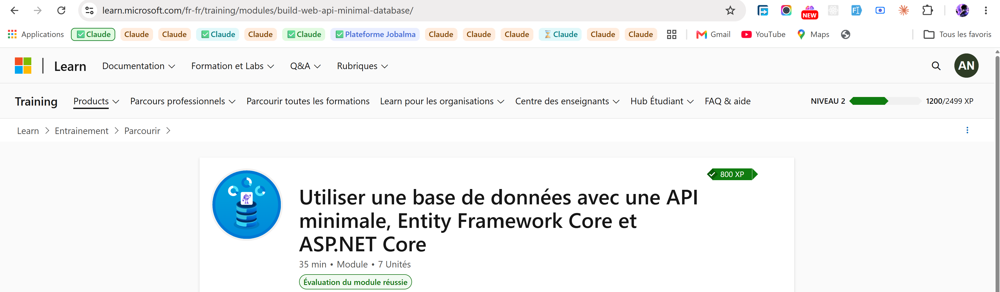

# POOAspEntity

TP « Enseignement .NET » — ESP / UCAD, Master 2 GLSI, 2026/2027 (E. H. Ousmane Diallo).

Objectif : utiliser une base de données avec une API minimale, Entity Framework Core et ASP.NET Core,
puis créer une application mobile .NET MAUI.

| Projet | Description | Module Microsoft Learn |
|---|---|---|
| `P5AspEntity` | API minimale ASP.NET Core + EF Core (SQLite), Swagger | [Utiliser une base de données avec une API minimale, EF Core et ASP.NET Core](https://learn.microsoft.com/fr-fr/training/modules/build-web-api-minimal-database/) |
| `P8Maui` | Application .NET MAUI (Android + Windows) : personnes en SQLite, MVVM, onglets | [Créer des applications mobiles et de bureau avec .NET MAUI](https://learn.microsoft.com/fr-fr/training/paths/build-apps-with-dotnet-maui/) |

## Capture Microsoft Learn



## Prérequis

- SDK **.NET 10** (LTS). Le fichier `global.json` impose le SDK 10.0.x, même si une version plus récente est installée.
  > Le sujet date de l'époque de .NET 8, mais le support de .NET 8 s'est terminé en novembre 2026. Le projet cible donc .NET 10 LTS.
- Outil EF Core : `dotnet tool install --global dotnet-ef --version 10.0.15`
- Pour P8Maui :
  - workload MAUI : `dotnet workload install maui` (dans un terminal administrateur) ;
  - un JDK 17 ou plus récent ;
  - le SDK Android (voir ci-dessous) et un émulateur ou un téléphone en mode développeur.

## P5AspEntity — API Pizza

```bash
cd P5AspEntity
dotnet ef database update            # crée Pizzas.db à partir des migrations
dotnet run --launch-profile http     # http://localhost:5112
```

- Swagger : <http://localhost:5112/swagger>
- Requêtes de test prêtes à l'emploi : `P5AspEntity/P5AspEntity.http` (Visual Studio, ou VS Code avec REST Client)

| Méthode | Route | Rôle | Réponses |
|---|---|---|---|
| GET | `/pizzas` | Liste de toutes les pizzas | 200 |
| GET | `/pizza/{id}` | Une pizza | 200, 404 |
| POST | `/pizza` | Crée une pizza (`{"name":"Thieb","description":"Pizza au poisson"}`) | 201 |
| PUT | `/pizza/{id}` | Modifie une pizza | 204, 404 |
| DELETE | `/pizza/{id}` | Supprime une pizza | 200, 404 |
| GET | `/toppings` | *(bonus)* Liste des garnitures | 200 |
| POST | `/topping` | *(bonus)* Crée une garniture (`{"name":"Oignons","price":500}`) | 201 |

Les deux étapes du module sont dans `Program.cs` :

1. la base **en mémoire** (`UseInMemoryDatabase("items")`), laissée en commentaire ;
2. la base **SQLite** (`AddSqlite<PizzaDb>`), qui est active. La chaîne de connexion est dans `appsettings.json`.

Migrations : `InitialCreate` (table Pizzas), puis `AddToppings` (bonus : évolution du schéma).

```bash
dotnet ef migrations add <NomDeLaMigration>   # après une modification des modèles
dotnet ef database update
```

## P8Maui — application .NET MAUI

Trois onglets (`TabBar` dans `AppShell.xaml`) :

- **Personnes** : ajouter, afficher et supprimer des personnes enregistrées dans SQLite (`people.db3`). Les données sont conservées après un redémarrage. La page est en MVVM : `MainViewModel`, liaisons `{Binding}` et commandes.
- **Phoneword** : l'application du module 1 (traduction d'un numéro écrit en lettres, puis appel).
- **À propos**.

### Lancer sous Windows (le plus rapide)

```bash
dotnet build P8Maui -f net10.0-windows10.0.19041.0 -t:Run
```

### Lancer sur Android

Installer d'abord le SDK Android (une seule fois). Ces commandes n'ont pas besoin des droits administrateur :

```bash
dotnet build P8Maui -t:InstallAndroidDependencies -f net10.0-android ^
  -p:AndroidSdkDirectory="%LOCALAPPDATA%\Android\Sdk" -p:AcceptAndroidSDKLicenses=True
```

Ensuite, démarrer un émulateur (créé avec le Device Manager d'Android Studio ou de Visual Studio), puis lancer :

```bash
dotnet build P8Maui -t:Run -f net10.0-android -p:AndroidSdkDirectory="%LOCALAPPDATA%\Android\Sdk"
```

## Structure

```
POOAspEntity/
├── POOAspEntity.sln
├── global.json                 # SDK .NET 10
├── P5AspEntity/
│   ├── Program.cs              # configuration + routes de l'API
│   ├── Models/                 # Pizza, Topping
│   ├── Data/PizzaDb.cs         # DbContext EF Core
│   ├── Migrations/             # InitialCreate, AddToppings
│   └── P5AspEntity.http
└── P8Maui/
    ├── MauiProgram.cs          # injection de dépendances
    ├── AppShell.xaml           # onglets
    ├── App.xaml                # styles partagés
    ├── MainPage.xaml           # page Personnes (vue)
    ├── ViewModels/MainViewModel.cs
    ├── PersonRepository.cs     # accès SQLite
    ├── Models/Person.cs
    └── PhonewordPage.xaml, PhonewordTranslator.cs, AboutPage.xaml
```
